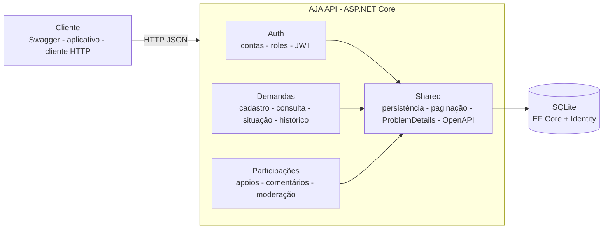
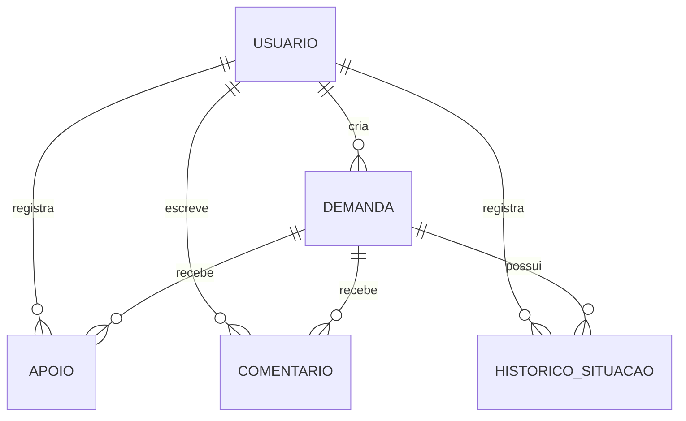
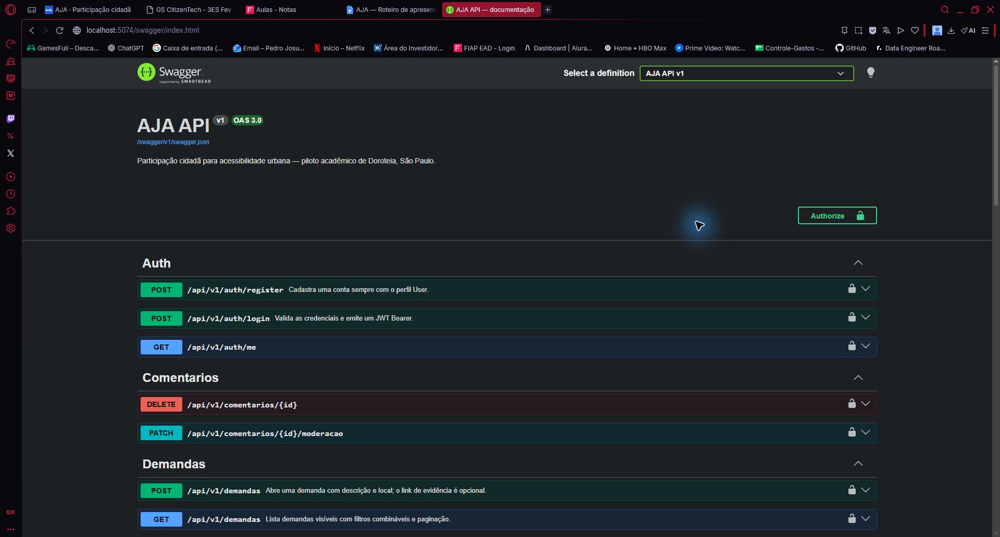
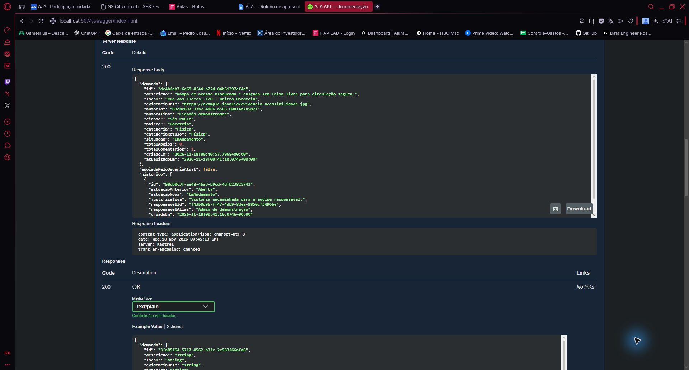

# AJA - C# Software Development

Backend em C#/.NET para participação cidadã no registro e acompanhamento de barreiras de acessibilidade urbana. O AJA permite que cidadãos registrem uma demanda, apoiem ocorrências existentes, comentem e acompanhem as providências registradas pela administração.

## Ficha da CitizenTech

| Campo | Definição |
|---|---|
| Nome da CitizenTech | **AJA - Acessibilidade, Justiça e Ação** |
| Cidade e bairro | São Paulo - piloto acadêmico no bairro Doroteia |
| Cidadão beneficiado | Pessoas com deficiência, idosos, acompanhantes, responsáveis por crianças e demais cidadãos afetados por barreiras no espaço urbano |
| Problema, em uma frase | Barreiras em calçadas e espaços públicos dificultam a mobilidade e nem sempre possuem um canal simples, transparente e comunitário para registro e acompanhamento |
| Como funciona | Uma pessoa cria uma demanda com descrição e local; a comunidade apoia e comenta; um administrador classifica a barreira e atualiza a situação com justificativa e histórico automático |
| Parte desenvolvida | Web API em C#/.NET com domínio orientado a objetos, autenticação JWT, autorização, Entity Framework Core, LINQ, SQLite, Swagger e testes automatizados |
| Link do repositório | O próprio repositório GitHub enviado na tarefa de C# Software Development |
| Indicadores de impacto | Quantidade de demandas registradas, apoios e comentários; percentual de demandas em andamento ou concluídas; tempo entre abertura e atualização de situação |
| ODS conectados | ODS 10 - Redução das Desigualdades; ODS 11 - Cidades e Comunidades Sustentáveis |

### Contribuição para os ODS

- **ODS 10 - Redução das Desigualdades:** o AJA cria um canal digital para dar visibilidade a barreiras que afetam de forma desproporcional pessoas com mobilidade reduzida e outros grupos que encontram dificuldade de acesso ao espaço urbano.
- **ODS 11 - Cidades e Comunidades Sustentáveis:** a solução apoia o registro, a priorização comunitária e o acompanhamento de problemas relacionados à acessibilidade de calçadas e espaços públicos.

Os dados usados na demonstração são simulados. O projeto não exige nem recomenda o uso de nomes, documentos, fotografias identificáveis ou outras informações pessoais reais.

## Integrantes

| Nome | RM |
|---|---|
| Guilherme Santos Nunes | RM558989 |
| Kaique Rodrigues Zaffarani | RM556677 |
| Pedro Josué Pereira Almeida | RM554913 |

## Visão funcional

1. O cidadão cria uma conta ou entra com uma conta existente.
2. Registra uma demanda informando descrição, local e, opcionalmente, uma URL de evidência.
3. Outros usuários consultam demandas, registram apoio e publicam comentários.
4. O administrador atribui a categoria de acessibilidade e altera a situação da demanda.
5. Cada mudança de situação exige uma justificativa e produz um item no histórico.
6. A comunidade consulta o resumo, a quantidade de apoios, os comentários visíveis e o histórico da demanda.

Categorias disponíveis:

- `Fisica`
- `Visual`
- `Auditiva`
- `Comunicacional`
- `Cognitiva`

Situações disponíveis:

- `Aberta`
- `EmAndamento`
- `Concluida`

## Arquitetura da aplicação

O projeto é um monólito modular. Cada módulo possui camadas de API, Application, Domain e Infrastructure, mantendo contratos HTTP, casos de uso, regras de negócio e detalhes técnicos separados.



### Estrutura de pastas

```text
src/Aja.Api/
  Program.cs
  Modules/
    Auth/
      Api/
      Application/
      Domain/
      Infrastructure/
    Demandas/
      Api/
      Application/
      Domain/
      Infrastructure/
    Participacoes/
      Api/
      Application/
      Domain/
      Infrastructure/
  Shared/
    Configuration/
    Errors/
    Persistence/
tests/
  Aja.UnitTests/
  Aja.IntegrationTests/
```

| Camada | Responsabilidade |
|---|---|
| `Api` | Controllers, rotas, códigos HTTP e autorização declarativa |
| `Application` | DTOs e interfaces dos casos de uso |
| `Domain` | Entidades, invariantes e comportamentos de negócio |
| `Infrastructure` | EF Core, Identity, JWT, consultas LINQ e implementações dos serviços |
| `Shared` | Persistência comum, paginação, OpenAPI e tratamento padronizado de erros |

## Programação Orientada a Objetos

As entidades possuem estado protegido por `private set` e expõem comportamentos que aplicam as regras do domínio:

- `Demanda.Editar` permite edição somente enquanto a demanda está aberta.
- `Demanda.AtualizarAdministracao` classifica a demanda e cria o histórico quando a situação muda.
- `Demanda.Remover` realiza remoção lógica e exige que a demanda esteja aberta.
- `Apoio.Registrar` e `Apoio.Retirar` implementam operações idempotentes.
- `Comentario.Remover` preserva o conteúdo e registra a remoção lógica.
- `Comentario.Ocultar` preserva autoria e registra a primeira moderação administrativa.

Os controllers dependem das abstrações `IAuthService`, `IDemandaService` e `IParticipacaoService`. As implementações são registradas no contêiner de injeção de dependência do ASP.NET Core, evitando que a camada HTTP acesse diretamente o banco ou detalhes de autenticação.

## Tecnologias e pré-requisitos

- .NET SDK 10.0.300, definido em `global.json`
- ASP.NET Core Web API com target `net10.0`
- Entity Framework Core 10.0.5
- SQLite 10.0.5
- ASP.NET Core Identity 10.0.5
- JWT Bearer 10.0.5
- Swashbuckle 10.1.7 para Swagger/OpenAPI
- xUnit 2.9.3
- Microsoft.AspNetCore.Mvc.Testing 10.0.5

Não é necessário instalar ou configurar um servidor de banco de dados externo.

## Executar o projeto

Na raiz do repositório:

```powershell
dotnet restore .\AJA.sln --configfile .\NuGet.Config
dotnet tool restore --configfile .\NuGet.Config
dotnet ef database update --project .\src\Aja.Api --startup-project .\src\Aja.Api
dotnet run --project .\src\Aja.Api
```

A aplicação estará disponível em:

- API HTTP: `http://localhost:5074`
- Swagger UI: `http://localhost:5074/swagger`
- OpenAPI JSON: `http://localhost:5074/swagger/v1/swagger.json`
- Health check: `http://localhost:5074/health`

O banco `aja.db` é criado localmente e recebe automaticamente as migrações pendentes. Arquivos de banco, chaves locais, backups e configurações secretas são ignorados pelo Git.

## Acesso de demonstração

No ambiente `Development`, a aplicação cria de forma idempotente a seguinte conta:

| Campo | Valor |
|---|---|
| Email | `admin@aja.local` |
| Senha | `Admin#Aja2026!` |
| Perfil | `Admin` |

Essa credencial é pública e existe somente para a demonstração acadêmica. Ela não deve ser reutilizada em outro ambiente.

Em `Development`, a chave JWT é gerada em memória a cada inicialização. Por isso, tokens emitidos localmente deixam de valer quando a aplicação reinicia. Fora de `Development`, `Jwt:Issuer`, `Jwt:Audience` e `Jwt:SigningKey` devem ser fornecidos por variáveis de ambiente, user-secrets ou cofre de segredos.

Exemplo para configuração externa:

```powershell
$env:Jwt__Issuer = 'AJA.Local'
$env:Jwt__Audience = 'AJA.Clientes'
$env:Jwt__SigningKey = 'substitua-por-uma-chave-com-32-bytes-ou-mais'
$env:AdminBootstrap__Enabled = 'false'
dotnet run --project .\src\Aja.Api
```

## Autenticação e autorização

O cadastro público sempre cria uma conta `User`. Uma pessoa não consegue solicitar a role `Admin` pelo corpo da requisição.

O token JWT:

- usa assinatura HMAC-SHA256;
- valida emissor, audiência, assinatura, algoritmo e expiração;
- possui validade padrão de 30 minutos;
- contém identificador, email, alias e role;
- nunca contém senha ou hash de senha.

O ASP.NET Core Identity armazena somente o hash da senha e bloqueia a conta durante 5 minutos depois de 5 tentativas inválidas. A política de quatro caracteres mínimos existe apenas para simplificar a demonstração acadêmica.

Regras de autorização:

- somente o autor edita ou remove sua demanda;
- somente o autor remove seu comentário;
- somente `Admin` classifica demandas, altera situações e modera comentários;
- demanda invisível ou removida não é exposta ao usuário sem autorização;
- erros internos são sanitizados e não devolvem stack trace.

### Exemplo de login Admin em PowerShell

```powershell
$login = Invoke-RestMethod `
  -Method Post `
  -Uri 'http://localhost:5074/api/v1/auth/login' `
  -ContentType 'application/json' `
  -Body (@{
    email = 'admin@aja.local'
    password = 'Admin#Aja2026!'
  } | ConvertTo-Json)

$token = $login.accessToken
```

No Swagger, clique em **Authorize** e informe somente o token, sem escrever o prefixo `Bearer`.

## Endpoints REST

Todas as operações funcionais usam o prefixo `/api/v1`.

| Método | Rota | Acesso | Resultado principal |
|---|---|---|---|
| `POST` | `/api/v1/auth/register` | Público | Cria uma conta `User` e retorna `201` |
| `POST` | `/api/v1/auth/login` | Público | Valida credenciais e retorna JWT com `200` |
| `GET` | `/api/v1/auth/me` | Autenticado | Retorna a própria conta com `200` |
| `POST` | `/api/v1/demandas` | Autenticado | Cria demanda e retorna `201` com `Location` |
| `GET` | `/api/v1/demandas` | Autenticado | Lista, filtra e pagina com `200` |
| `GET` | `/api/v1/demandas/{id}` | Autenticado | Retorna resumo, totais e histórico com `200` |
| `PUT` | `/api/v1/demandas/{id}` | Autor | Edita demanda aberta com `200` |
| `DELETE` | `/api/v1/demandas/{id}` | Autor | Remove demanda aberta sem participação e retorna `204` |
| `PATCH` | `/api/v1/demandas/{id}` | Admin | Classifica ou altera situação com `200` |
| `PUT` | `/api/v1/demandas/{id}/apoio` | Autenticado | Registra apoio idempotente e retorna `204` |
| `DELETE` | `/api/v1/demandas/{id}/apoio` | Autenticado | Retira apoio idempotente e retorna `204` |
| `POST` | `/api/v1/demandas/{id}/comentarios` | Autenticado | Cria comentário e retorna `201` |
| `GET` | `/api/v1/demandas/{id}/comentarios` | Autenticado | Lista comentários comunitários visíveis com `200` |
| `DELETE` | `/api/v1/comentarios/{id}` | Autor | Remove comentário logicamente e retorna `204` |
| `PATCH` | `/api/v1/comentarios/{id}/moderacao` | Admin | Oculta comentário com motivo e retorna `200` |

Filtros disponíveis em `GET /api/v1/demandas`:

- `situacao`
- `categoria`
- `bairro`
- `minhas`
- `page`
- `pageSize`, entre 1 e 100

## Exemplo da jornada principal

### 1. Cadastrar um cidadão

```http
POST /api/v1/auth/register
Content-Type: application/json

{
  "email": "cidadao@example.invalid",
  "alias": "Pessoa participante",
  "password": "1234"
}
```

### 2. Criar uma demanda autenticada

```http
POST /api/v1/demandas
Authorization: Bearer SEU_TOKEN
Content-Type: application/json

{
  "descricao": "Entulho bloqueia a faixa livre da calçada e dificulta a passagem.",
  "local": "Em frente à entrada principal da praça."
}
```

### 3. Registrar apoio

```http
PUT /api/v1/demandas/ID_DA_DEMANDA/apoio
Authorization: Bearer SEU_TOKEN
```

Repetir a requisição não duplica o apoio.

### 4. Comentar

```http
POST /api/v1/demandas/ID_DA_DEMANDA/comentarios
Authorization: Bearer SEU_TOKEN
Content-Type: application/json

{
  "texto": "A barreira também dificulta a passagem de carrinhos e cadeiras de rodas."
}
```

### 5. Classificar e iniciar o atendimento como Admin

```http
PATCH /api/v1/demandas/ID_DA_DEMANDA
Authorization: Bearer TOKEN_ADMIN
Content-Type: application/json

{
  "categoria": "Fisica",
  "situacao": "EmAndamento",
  "justificativa": "A demanda foi classificada e encaminhada para análise."
}
```

## Modelo de dados e Entity Framework Core



Principais garantias relacionais:

- chaves estrangeiras ligam autoria e administração às contas do Identity;
- o índice único `(DemandaId, UsuarioId)` impede apoio duplicado;
- remoções de demandas e comentários são lógicas;
- histórico de situação é persistido separadamente da demanda;
- `DateTimeOffset` é convertido de forma consistente para SQLite;
- índices apoiam consultas por situação, categoria, bairro e data.

O serviço de demandas usa LINQ para combinar filtros, contar registros, ordenar antes da paginação, projetar DTOs, agregar apoios e comentários e executar tudo no provedor relacional. As consultas de leitura usam `AsNoTracking` quando a entidade não será modificada.

Migrações incluídas:

1. `20261114051059_InitialCreate`
2. `20261114215256_SimplifiedDemandFlow`

O `Program.cs` executa `Database.MigrateAsync` na inicialização. Também é possível aplicar a cadeia explicitamente:

```powershell
dotnet ef database update --project .\src\Aja.Api --startup-project .\src\Aja.Api
```

## Programação assíncrona

Controllers e serviços retornam `Task` e usam `async/await` em todo o fluxo. Persistência e consultas utilizam operações como:

- `SaveChangesAsync`
- `CountAsync`
- `ToListAsync`
- `SingleOrDefaultAsync`
- `AnyAsync`
- APIs assíncronas do ASP.NET Core Identity

O `CancellationToken` recebido pelo endpoint é propagado até o EF Core. Não há bloqueios com `.Result` ou `.Wait()` no código da aplicação.

## Erros padronizados

Falhas conhecidas são devolvidas como `application/problem+json`:

```json
{
  "type": "about:blank",
  "title": "Conflito",
  "status": 409,
  "detail": "Somente uma demanda Aberta pode ser editada.",
  "instance": "/api/v1/demandas/00000000-0000-0000-0000-000000000000",
  "code": "demanda_nao_aberta",
  "traceId": "..."
}
```

Códigos usados:

- `400` para entrada inválida;
- `401` para token ausente, inválido ou credenciais incorretas;
- `403` para violação de role ou autoria;
- `404` para recurso inexistente ou invisível;
- `409` para conflito com uma regra do domínio;
- `500` sanitizado para falha inesperada.

## Evidências de execução

As imagens abaixo foram registradas com a aplicação em execução no ambiente `Development`, usando o Swagger UI disponibilizado pelo próprio projeto.

### Documentação e endpoints REST

A interface OpenAPI apresenta a AJA API, a autenticação Bearer e os grupos de endpoints de autenticação, demandas, participações, comentários e health check.



### Health check

A rota pública `GET /health` confirma que a aplicação iniciou corretamente e está pronta para receber requisições.


### Consulta autenticada e histórico

A chamada autenticada `GET /api/v1/demandas/{id}` retorna `200 OK` e reúne os dados da demanda, a categoria `Fisica`, a situação `EmAndamento`, os totais de participação e o histórico da alteração administrativa com justificativa.



## Testes e verificação

```powershell
dotnet build .\AJA.sln --no-restore
dotnet test .\AJA.sln --no-build --logger 'console;verbosity=minimal'
```

Resultado da verificação da entrega:

- build com 0 erros e 0 avisos;
- 9 casos unitários aprovados;
- 12 testes de integração aprovados;
- total de 21 testes, sem falhas.

Os testes unitários validam criação, edição, mudança de situação, histórico, URLs HTTP/HTTPS, apoio idempotente, remoção e moderação. Os testes de integração iniciam a aplicação pelo pipeline real, usam SQLite isolado e verificam:

- cadastro e login;
- JWT válido, adulterado, expirado ou com emissor/audiência incorretos;
- respostas `401` e `403`;
- autoria e role Admin;
- criação, edição e remoção de demandas;
- apoio único e comentários;
- filtros LINQ e paginação;
- persistência após reiniciar a aplicação;
- chaves estrangeiras e índices únicos;
- aplicação das migrações;
- documento OpenAPI com as 15 operações funcionais.


